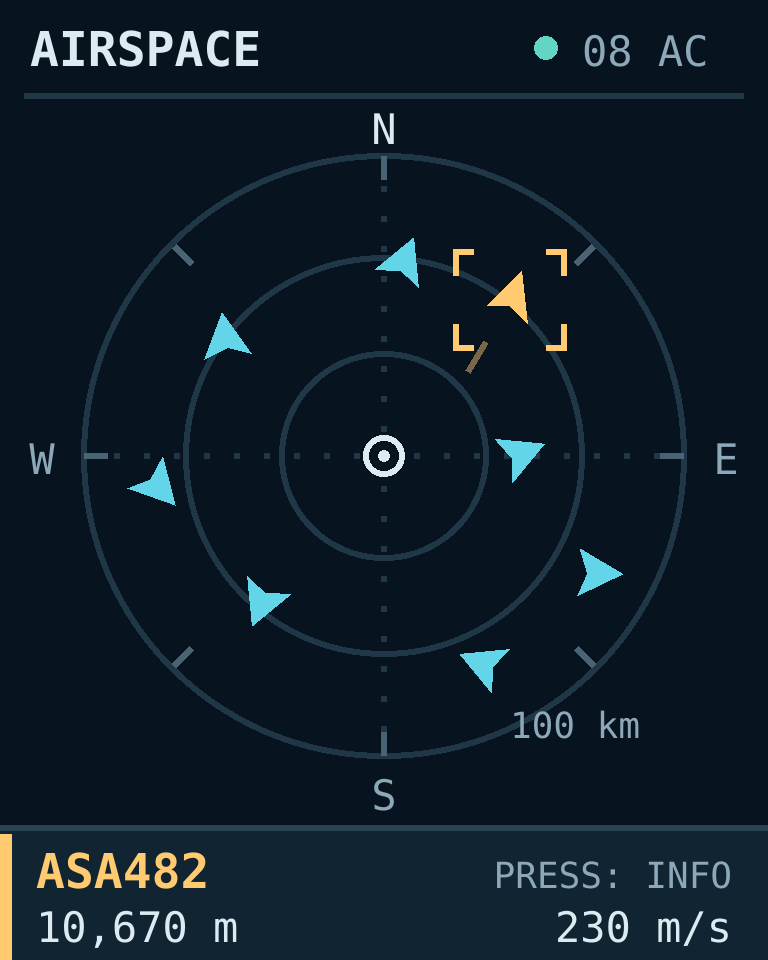

# ESP32 Flight Radar

A small desk-top "airspace" display that shows live aircraft around a fixed location on a 1.8" TFT screen. An ESP32 pulls aircraft positions from the [OpenSky Network](https://opensky-network.org/) API every 10 seconds and draws them on a north-up radar, with a joystick to select aircraft and view their details.



## Features

- North-up radar with range rings at roughly 34, 66, and 100 km
- Directional aircraft markers rotated to each flight's heading
- Joystick navigation that moves the selection to the nearest aircraft in the pushed direction
- Footer showing the selected aircraft's callsign, altitude, and speed
- Details page with origin country, altitude, speed, and heading
- Selection is kept across refreshes, as long as the same aircraft is still in range
- If a refresh fails, the last data stays on screen and the header shows a stale indicator

## Hardware

| Part | Notes |
| --- | --- |
| ESP32 dev board (ESP-WROOM-32) | `esp32dev` board in PlatformIO |
| 1.8" 128×160 TFT, ST7735 driver, SPI | 3.3 V, "green tab" variant |
| Analog joystick module | Two axes plus a push button |

See [docs/hardware-specs.md](docs/hardware-specs.md) for the exact modules used.

### Wiring

**TFT display**

| TFT pin | ESP32 |
| --- | --- |
| BL | 3.3V |
| CS | GPIO 15 |
| DC | GPIO 2 |
| RES | GPIO 4 |
| SDA (MOSI) | GPIO 23 |
| SCL (SCLK) | GPIO 18 |
| VCC | 3.3V |
| GND | GND |

**Joystick**

| Joystick pin | ESP32 |
| --- | --- |
| +5V | 3.3V |
| GND | GND |
| VRx | GPIO 34 |
| VRy | GPIO 35 |
| SW | GPIO 32 |

The display pins are set as build flags in `platformio.ini` (TFT_eSPI is configured there, not in a `User_Setup.h`). The joystick pins are set in `src/main.cpp`.

## Setup

### 1. Prerequisites

- [PlatformIO](https://platformio.org/) (the VS Code extension or the CLI)
- An OpenSky Network account with an API client. Create the client in your OpenSky account settings to get a client ID and secret. The firmware authenticates with the OAuth2 client-credentials flow.

### 2. Add your credentials

Create `src/secrets.h`. Git ignores this file, so your credentials stay out of the repo.

```cpp
#pragma once
#define OPENSKY_CLIENT_ID     "your-client-id"
#define OPENSKY_CLIENT_SECRET "your-client-secret"
#define WIFI_SSID             "your-wifi-name"
#define WIFI_PASSWORD         "your-wifi-password"
```

The ESP32 only supports 2.4 GHz Wi-Fi.

### 3. Set your location

Change the home coordinates in `src/main.cpp`:

```cpp
double currentLat = 37.8199;   // Golden Gate Bridge, San Francisco
double currentLon = -122.4783;
```

### 4. Build and flash

```sh
pio run --target upload
pio device monitor        # serial output at 115200 baud
```

PlatformIO installs the dependencies, [ArduinoJson](https://arduinojson.org/) and [TFT_eSPI](https://github.com/Bodmer/TFT_eSPI), on the first build.

## Usage

| Input | Radar screen | Details screen |
| --- | --- | --- |
| Joystick up/down/left/right | Select the nearest aircraft in that direction | — |
| Press joystick | Open details for the selected aircraft | Return to the radar |

The header shows how many aircraft are in range. A dot in the header means the latest refresh worked. If it changes to the stale indicator, the last refresh failed and the screen is showing older data. Check the serial monitor for the error.

### Joystick calibration

Joystick modules vary. If the selection moves on its own or doesn't respond, read the resting values from the analog pins and change these constants in `src/main.cpp`:

```cpp
const int JOY_Y_CENTER = 1880;
const int JOY_X_CENTER = 1935;
const int JOY_DEAD_ZONE = 800;
```

If your joystick is mounted in a different orientation, you may also need to swap the directions in `handleRadarSreen()`.

## How it works

```
src/
├── main.cpp            Wi-Fi setup, joystick input, screen state, refresh timer
├── api.cpp/.h          OpenSky OAuth token + /states/all request and JSON parsing
├── flight_tracker.*    Holds the current flight list, refresh logic, and selection
├── flight_geometry.*   Projects lat/lon into radar pixel coordinates
└── ui.cpp/.h           All TFT drawing: radar, aircraft markers, footer, details page
```

1. **Fetch.** `getFlights()` requests every aircraft inside a ±1° box around home. It caches the access token and fetches a new one shortly before it expires.
2. **Track.** `FlightTracker::refresh()` swaps in the new list and selects the same aircraft (matched by ICAO24 address) as before. If that aircraft is gone, it selects the first one in range. On failure, it keeps the old list and marks the data stale.
3. **Project.** `calculate_flight_positions()` converts each aircraft's distance and bearing from home into a point on the 50-pixel radar, which covers 100 km. Aircraft beyond that range are left off the screen.
4. **Draw.** `ui.cpp` draws to an off-screen sprite and then pushes it to the display, so the screen doesn't flicker.

Design notes for the radar layout, colors, and footer rules are in [docs/design/radar-design.md](docs/design/radar-design.md).

## Notes and limitations

- TLS certificate checks are turned off (`client.setInsecure()`) to keep the firmware simple. The connection is encrypted, but the server's identity isn't verified.
- The home location is fixed at compile time.
- OpenSky limits API usage per account. Refreshing every 10 seconds may use up the daily credits on lower tiers. If so, increase `UPDATE_INTERVAL_MS` in `src/main.cpp`.
- The radar only refreshes while it's on screen. It pauses while the details page is open.
